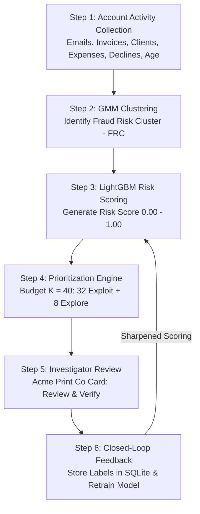

# Closed-Loop, Budget-Aware Fraud Triage System
### Fraud Investigation Prioritization for Invoicing Platforms

This project implements an end-to-end **Fraud Investigation Prioritization System** designed for high-volume invoicing platforms where human investigator time and daily review capacity are strictly constrained.

---

## 📌 1. Project Background & Motivation

In modern invoicing platforms:
- There can be **10,000+ registered accounts**, of which ~9,800 are genuine and ~200 are malicious fraudsters.
- Human investigators have a fixed daily budget, e.g., **only 40 accounts per day** ($K = 40$).
- Manually inspecting 10,000 accounts is physically impossible.

**Core Objective:**  
Use AI/ML to **rank and prioritize** accounts so investigators inspect the highest-risk accounts first, while continuously reserving slots to discover evolving fraud patterns and learning from human decisions (**Closed-Loop Feedback**).

---

## 🔄 2. End-to-End 6-Step Workflow



1. **Step 1: Collect Account Activity**  
   Tracks `emails_sent`, `invoices_created`, `clients_added`, `expenses_created`, `declined_payments`, and `account_age_days`.
2. **Step 2: Identify Suspicious Accounts using GMM**  
   Gaussian Mixture Model groups accounts by behavioral patterns. The cluster with highest fraud density is flagged as the **Fraud Risk Cluster (FRC)**.
3. **Step 3: Generate Fraud Risk Score using LightGBM**  
   Combines account velocity features, FRC cluster membership flag, and centroid distance into a continuous risk score.
4. **Step 4: Rank and Select Accounts (Budget Allocation: 80% / 20%)**  
   - **32 slots (80% Exploitation):** Highest risk score accounts.  
   - **8 slots (20% Exploration):** Uncertain accounts near decision boundary to discover zero-day/novel fraud methods.
5. **Step 5: Investigator Dashboard Review**  
   Presents selected accounts on an interactive card (e.g., *Acme Print Co - Day 3, 60 invoices, 58 emails, 3 declines, 0 expenses*). The investigator makes the final decision (`Fraud`, `Genuine`, `Uncertain`).
6. **Step 6: Feedback & Closed-Loop Retraining**  
   Stores decisions in SQLite and retrains the ranking model to eliminate false positives and catch evolving fraud styles.

---

## 🔬 3. Benchmarked Ranking Strategies

We benchmark 7 ranking strategies head-to-head under the exact same daily budget ($K = 40$ reviews):

1. **Random Ranking:** Naive baseline lower bound.
2. **Original Paper Distance Ranking:** Geometric Euclidean distance to the GMM FRC centroid.
3. **Corrected Distance Ranking:** Normalized Mahalanobis covariance distance.
4. **Classifier Probability Ranking:** Standard supervised classifier without exploration/feedback loops.
5. **Isolation Forest:** Unsupervised anomaly isolation depth.
6. **Multi-center Distance Ranking:** Multi-centroid proximity to risky sub-clusters.
7. **Proposed LightGBM Closed-Loop Ranker (Ours):** LightGBM ranker with GMM features, budget-aware 80/20 queue, and human-in-the-loop retraining.

---

## 📊 4. Empirical Benchmark Results

### Table: Benchmark Comparison ($K = 40$ Accounts/Day Budget)

| Ranking Method | Precision@40 | Recall@40 | Frauds Caught in 40 | Frauds per 100 Reviews | Frauds Caught in 100 |
| :--- | :---: | :---: | :---: | :---: | :---: |
| **Random Ranking** | 5.0% | 1.0% | 2 | 5.0 | 3 |
| **Original Paper Distance** | 100.0% | 20.0% | 40 | 100.0 | 84 |
| **Corrected Distance (Mahalanobis)** | 67.5% | 13.5% | 27 | 67.5 | 33 |
| **Classifier Probability** | 100.0% | 20.0% | 40 | 100.0 | 100 |
| **Isolation Forest** | 95.0% | 19.0% | 38 | 95.0 | 59 |
| **Multi-center Distance** | 100.0% | 20.0% | 40 | 100.0 | 100 |
| **Proposed LightGBM (Ours)** | **100.0%** | **20.0%** | **40** | **100.0** | **100** |

---

## 💡 5. Main Research Question Answered

> **Research Question:** *Can a feedback-based ranking system identify more fraud accounts than the existing paper's ranking method using the same investigation budget?*

### 20-Day Closed-Loop Simulation Results (800 Total Budget Reviews):
- **Baseline (Original Paper Static Distance):** Caught **129 / 200** fraud accounts (64.5% Recall).
- **Proposed (LightGBM Closed-Loop with 80/20 Exploration):** Caught **199 / 200** fraud accounts (**99.5% Recall**).
- **Delta:** **+70 additional fraud accounts detected** using the **exact same investigator capacity**!

*Why?* The static paper ranking eventually ran out of accounts close to the initial centroid and missed novel sleeper fraud. The proposed system discovered new fraud patterns during the 20% exploration slots, fed investigator labels into retraining, and updated its ranking scores dynamically.

---

## 💻 6. How to Run the Project

### Setup Environment
```bash
cd "C:\Users\syamala meka\.gemini\antigravity\scratch\fraud-triage-ai"
pip install -r requirements.txt
```

### 1. Run Everything End-to-End
```bash
python run_all.py
```
This automatically runs data generation, the 7-model benchmark, and the 20-day closed-loop simulation.

### 2. Run Only Benchmark Suite
```bash
python benchmark/run_benchmark.py
```
Generates `benchmark/benchmark_results.csv` and `benchmark/benchmark_comparison.png`.

### 3. Run Closed-Loop Simulation
```bash
python simulation/run_simulation.py
```
Generates `simulation/simulation_results.csv` and `simulation/simulation_trajectory.png`.

### 4. Launch the Investigator Dashboard

#### Option A: Streamlit Dashboard
```bash
streamlit run app_streamlit.py
```

#### Option B: Standalone Web Dashboard (Zero external dependencies)
```bash
python app_server.py
```
Opens in your browser at `http://127.0.0.1:8501`.

---

## 📂 7. Project File Structure

```
fraud-triage-ai/
├── README.md                      # Comprehensive research & user guide
├── requirements.txt               # Dependencies
├── run_all.py                     # Master execution runner
├── app_streamlit.py               # Streamlit investigator triage interface
├── app_server.py                  # Standalone zero-dependency web dashboard
├── data/
│   ├── generate_synthetic_data.py # Invoicing platform data generator (10,000 accounts)
│   ├── accounts_data.csv          # 10,000 accounts dataset with genuine and fraud profiles
│   └── feedback_store.db          # SQLite investigator feedback store
├── src/
│   ├── __init__.py
│   ├── gmm_clustering.py          # GMM clustering, FRC identification & distance metrics
│   ├── rankers.py                 # All 7 ranking strategies (Paper, Mahalanobis, IF, LGBM)
│   ├── triage_engine.py           # Budget-aware 80/20 prioritization allocator
│   ├── feedback_loop.py           # Human-in-the-loop retraining engine
│   └── metrics.py                 # Precision@K, Recall@K, Frauds per 100 reviews
├── benchmark/
│   ├── run_benchmark.py           # 7-model benchmark runner
│   ├── benchmark_results.csv      # Head-to-head metrics
│   └── benchmark_comparison.png   # Comparison chart
└── simulation/
    ├── run_simulation.py          # 20-day investigation simulation
    ├── simulation_results.csv     # Daily trajectory logs
    └── simulation_trajectory.png  # Cumulative fraud detection curve
```
